# GRM Inventory Management System — Architecture & System Design

## 1. Architectural Principles

The application is architected around a **Single Centralized Inventory Ledger** and a **Modular Server-Rendered MVC Pattern**:

1. **Central Immutable Stock Ledger**: Production, purchase, warehouse, retail shop, website, and WhatsApp never maintain disparate stock logic. Every stock change passes through [`app/Services/StockService.php`](file:///c:/xampp/htdocs/grm-inventory/app/Services/StockService.php).
2. **ACID Transactional Integrity**: All multi-step inventory adjustments, POS checkouts, returns, and dispatches are wrapped in PDO transactions with row-level locks (`SELECT ... FOR UPDATE`).
3. **Stateless MVC Front-Controller**: All HTTP requests are processed through [`public/index.php`](file:///c:/xampp/htdocs/grm-inventory/public/index.php) via dynamic routing and PSR-4 compatible SPL autoloading.
4. **Defense-in-Depth Security**: Layered security via CSRF verification, session integrity, authentication middleware, permission gating, SQL prepared statements, and HTML escaping.

---

## 2. High-Level Architecture Diagram

```mermaid
flowchart TD
    subgraph ClientLayer [Client & Hardware Interface]
        Browser[Desktop / Tablet Browser]
        Scanner[Barcode / QR USB Scanner]
        Printer[Thermal POS / A4 Laser Printer]
    end

    subgraph EntryPoint [Front Controller & Security Gateways]
        Apache[.htaccess / Routing Rewrite]
        FrontController[public/index.php]
        SPL[SPL Dynamic Class Autoloader]
        AuthMW[AuthMiddleware]
        PermMW[PermissionMiddleware]
        CSRF[CSRF Validator]
    end

    subgraph ControllerLayer [Controller Orchestration]
        AdminCtrl[AdminController]
        ProdCtrl[ProductionController]
        WhCtrl[WarehouseController]
        ShopCtrl[ShopController]
        WebCtrl[WebsiteController]
        WaCtrl[WhatsappController]
        CashCtrl[CashController]
        AssetCtrl[AssetController]
        RepCtrl[ReportController]
        SysCtrl[SystemController]
    end

    subgraph ServiceLayer [Business Logic & Engines]
        StockSvc[StockService - Central Ledger]
        WhSvc[WarehouseService]
        ShopSvc[ShopService]
        ProdSvc[ProductionService]
        ExpSvc[ExpenseService]
        CashSvc[CashService]
        AssetSvc[AssetService]
        AuditSvc[AuditService]
        BackupSvc[BackupService]
        MailSvc[MailService]
        CloudSvc[CloudinaryService]
    end

    subgraph DataLayer [Storage & Persistence]
        DB[(MariaDB / MySQL 82 Relational Tables)]
        CloudMedia[(Cloudinary Media CDN)]
        LocalLogs[storage/logs/error.log]
        LocalBackups[storage/backups/]
    end

    Browser --> Apache --> FrontController --> SPL --> CSRF --> AuthMW --> PermMW
    PermMW --> ControllerLayer
    ControllerLayer --> ServiceLayer
    ServiceLayer --> DataLayer
    Scanner -.-> Browser
    Printer <-.- Browser
```



---

## 3. Application Directory Structure

```text
c:\xampp\htdocs\grm-inventory\
├── app/
│   ├── Controllers/          # 13 Application Controllers
│   │   ├── AdminController.php
│   │   ├── AssetController.php
│   │   ├── AuthController.php
│   │   ├── CashController.php
│   │   ├── MasterController.php
│   │   ├── ProductionController.php
│   │   ├── ReportController.php
│   │   ├── SalesController.php
│   │   ├── ShopController.php
│   │   ├── SystemController.php
│   │   ├── WarehouseController.php
│   │   ├── WebsiteController.php
│   │   └── WhatsappController.php
│   ├── Helpers/              # Core System Helpers
│   │   ├── Database.php      # PDO Singleton & Transaction Manager
│   │   ├── Session.php       # Secure Session & Flash Manager
│   │   ├── CSRF.php          # CSRF Token Generator & Validator
│   │   ├── Validator.php     # Input Validation Engine
│   │   └── Response.php      # JSON, Views, Redirects, URL Resolvers
│   ├── Middleware/           # Request Filters
│   │   ├── AuthMiddleware.php
│   │   └── PermissionMiddleware.php
│   ├── Models/               # Data Access & Entity Definitions
│   │   ├── User.php
│   │   ├── Role.php
│   │   ├── Product.php
│   │   ├── ProductVariant.php
│   │   ├── Warehouse.php
│   │   ├── Shop.php
│   │   ├── ProductionUnit.php
│   │   ├── Location.php
│   │   └── ...
│   └── Services/             # Domain Logic & Business Engines
│       ├── StockService.php
│       ├── WarehouseService.php
│       ├── ShopService.php
│       ├── ProductionService.php
│       ├── ExpenseService.php
│       ├── CashService.php
│       ├── AssetService.php
│       ├── AuditService.php
│       ├── BackupService.php
│       ├── MailService.php
│       ├── SettingsService.php
│       └── CloudinaryService.php
├── config/                   # Configuration Files
│   ├── app.php               # Timezone, Locale, Currency, Env loader
│   ├── database.php          # PDO MySQL Connection Settings
│   └── cloudinary.php        # Cloudinary API Credentials
├── database/                 # Database Schema & Migrations
│   ├── schema.sql            # Master DDL Script (82 tables)
│   ├── seed.sql              # Master Seed Data
│   └── migrations/           # Incremental Schema Evolution Scripts
├── public/                   # Public Document Root
│   ├── index.php             # Front Controller Entry Point
│   ├── assets/               # CSS, JS, Fonts, Vendor Libraries
│   │   ├── css/
│   │   └── js/
│   └── uploads/              # Local temporary upload buffers
├── requirements/             # Comprehensive Project Documentation
├── routes/                   # Routing Declarations
│   └── web.php               # Full Web & API Route Map
├── storage/                  # Application Storage & Logs
│   ├── backups/              # Database SQL/ZIP Dumps
│   └── logs/                 # error.log & application audit logs
├── .env                      # Environment Variables
├── .htaccess                 # Apache Rewrite & Security Rules
└── index.php                 # Project Root Forwarding Entry Point
```

---

## 4. Central Inventory Engine (`StockService`)

Stock in the application is never mutated by ad-hoc `UPDATE` queries. It follows a **Double-Entry Ledger Pattern**:

```text
Stock Unique Key: [Variant ID] + [Location Type] + [Location ID] + [Stock Pool Status]
```

### Supported Location Types:
- `PRODUCTION` (Factory / Manufacturing Unit)
- `WAREHOUSE` (Central Hub)
- `SHOP` (Retail Outlet)
- `CHANNEL` (Digital Warehouse / WhatsApp / Website Allocation)

### Supported Stock Pool Statuses:
- `AVAILABLE` (Ready for sale / allocation)
- `RESERVED` (Allocated for order picking / in-transit)
- `DAMAGED` (Defective / QC Rejected / Customer Return Damage)
- `IN_PRODUCTION` (Cutting & Stitching Work-In-Progress)

### Core Transaction Methods:
```php
StockService::increase(int $variantId, string $locType, int $locId, float $qty, string $pool, string $refType, int $refId, ?string $notes);
StockService::decrease(int $variantId, string $locType, int $locId, float $qty, string $pool, string $refType, int $refId, ?string $notes);
StockService::reserve(int $variantId, string $locType, int $locId, float $qty, string $refType, int $refId);
StockService::release(int $variantId, string $locType, int $locId, float $qty, string $refType, int $refId);
StockService::transfer(int $variantId, string $srcType, int $srcId, string $destType, int $destId, float $qty, string $refType, int $refId);
StockService::adjust(int $variantId, string $locType, int $locId, float $newQty, string $pool, string $reason, int $userId);
```

Every method:
1. Locks the `stock_balances` record with `SELECT ... FOR UPDATE`.
2. Updates or creates the `stock_balances` snapshot.
3. Appends an immutable record to `stock_transactions` with previous balance, changed quantity, new balance, user ID, and timestamp.

---

## 5. End-to-End Workflow Lifecycles

### 5.1 Garment Manufacturing Pipeline
```text
Fabric Roll Purchase (Seller & GSM Master)
   ↓
Roll Damage & Width Inspection
   ↓
Production Program Planning (Style, Ratio, Units)
   ↓
Cutting Batch (Layers, Roll Consumption, Bundles) → Wastage Sale Entry
   ↓
Stitching Job Card (Tailor Allocation, Bundles) → Stitching Wastage Sale Entry
   ↓
Brand & Size Label Batch Stitching
   ↓
Quality Control (QC) Inspection (A-Grade Pass / B-Grade Rework / Rejection)
   ↓
Production Batch Formation & QR Carton Labeling
   ↓
Outward Dispatch & Gate Pass Generation
   ↓
Warehouse GRN Inward (QR Scanning & Physical Verification)
```

### 5.2 Warehouse Allocation & Retail Fulfillment Pipeline
```text
Warehouse Available Stock
   ↓
Store Allocation Order (Shop / WhatsApp / Website)
   ↓
Stock Reservation (Available - Qty, Reserved + Qty)
   ↓
Picking List Generation & Bin Navigation
   ↓
Carton Packing & Barcode Cross-Check
   ↓
Outward Dispatch & Security Gate Pass
   ↓
Delivery Tracking & Store Receipt Verification
   ↓
Destination Stock Received (Store Available + Qty, Warehouse Reserved - Qty)
```

### 5.3 Retail POS & Customer Return Lifecycle
```text
Barcode / QR Scan at POS
   ↓
Customer Lookup / Instant Add
   ↓
Cart Discounts, Tax & GST Computation
   ↓
Multi-Tender Payment (Cash, UPI, Card, Credit)
   ↓
Sale Complete → Instant Stock Deduction & Thermal Invoice
   ↓
[Customer Return Event]
   ↓
Return Lookup by Invoice / Phone
   ↓
Condition Inspection (Good -> Resellable Stock | Damaged -> Defective Pool)
   ↓
Action Selection (Refund / Same-Product Size Swap / Catalog Exchange)
   ↓
Price Difference Settlement (Collect / Refund / Even Swap)
   ↓
Updated Exchange Tax Receipt Printed
```

---

## 6. Security Architecture

1. **Session Hardening**: Sessions configured with `HTTPOnly`, `SameSite=Lax`, strict mode, and session ID regeneration upon privilege escalation.
2. **CSRF Tokens**: Every mutating form includes a cryptographically secure 256-bit CSRF token checked via [`CSRF::validateToken()`](file:///c:/xampp/htdocs/grm-inventory/app/Helpers/CSRF.php).
3. **Audit Trails**: All sensitive actions (staff changes, role edits, stock adjustments, expense vouchers, cash register closes) write audit logs to `audit_logs` table via [`AuditService::log()`](file:///c:/xampp/htdocs/grm-inventory/app/Services/AuditService.php).
4. **Dynamic URL Binding**: [`Response::url()`](file:///c:/xampp/htdocs/grm-inventory/app/Helpers/Response.php) automatically adapts to host IP, domain, and port configurations without hardcoded path dependencies.
