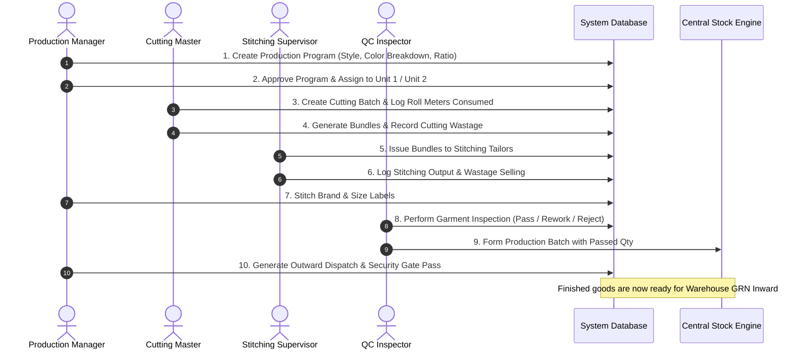
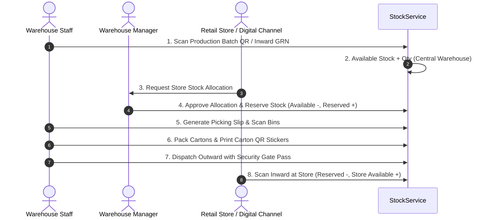

# GRM Inventory Management System — Module Workflows & Functional Specifications

## 1. Production & Manufacturing Workflows

---

## 2. Central Warehouse & Allocation Workflows

---

## 3. Retail POS Billing & Customer CRM Workflows

### 3.1 Point of Sale (POS) Fast Billing
1. **Keystroke Scanner Listener**: Keystroke buffers automatically detect USB barcode scanner inputs, instantly matching `product_variants.sku` or `qr_code`.
2. **Customer Integration**: Look up customer by phone number or name; one-click inline modal to add new customer with GSTIN.
3. **Discounts & GST**: Item-level and invoice-level percentage/flat discounts; automatic CGST (9%) + SGST (9%) or IGST (18%) computation.
4. **Split Tender Payments**: Support for Cash, UPI, Card, and Customer Credit.
5. **Instant Stock Deduction**: `StockService::decrease(...)` immediately debits store-level `AVAILABLE` stock for every item.
6. **Receipt Output**: Thermal receipt (80mm) with business header, itemized breakdown, tax summary, QR code, and footer policy.

---

## 4. Multi-Channel Returns & Exchange System

### 4.1 Return & Exchange Matrix
| Scenario | Stock Impact | Financial Impact | Document Generated |
| :--- | :--- | :--- | :--- |
| **Direct Refund (Good)** | Warehouse/Shop `AVAILABLE` +Qty | Refund cash/UPI to customer | Return Voucher / Credit Note |
| **Direct Refund (Damaged)**| Warehouse/Shop `DAMAGED` +Qty | Refund cash/UPI to customer | Damage Return Voucher |
| **Same-Product Size Swap** | Returned Item +Qty, Replacement Item -Qty | Price Difference = ₹0.00 | Exchange Tax Invoice |
| **Higher Value Catalog Swap** | Returned Item +Qty, New Item -Qty | Customer pays difference (`COLLECT`) | Exchange Tax Invoice |
| **Lower Value Catalog Swap** | Returned Item +Qty, New Item -Qty | Store refunds difference (`REFUND`) | Exchange Tax Invoice |

---

## 5. Petty Cash & Cash Flow Management

1. **Shift Opening**: Cashier enters opening drawer float (e.g. ₹2,000.00).
2. **Cash Inflows**: Automated cash revenue accumulation from completed POS cash transactions; manual cash-in vouchers for float top-ups.
3. **Cash Outflows**: Store tea, refreshments, cleaner payments, staff food, and minor repair expense vouchers logged directly against the active register.
4. **Bank Deposits**: Cashier records mid-day or end-of-day bank deposits with slip/reference number.
5. **Shift Closing & Reconciliation**: Cashier counts physical cash; system compares expected drawer cash vs counted cash, highlighting surplus or shortage, locking shift audit.

---

## 6. Fixed Asset & Plant Machinery Management

1. **Asset Master**: Registration of cutting machines, single-needle lockstitch, overlock machines, generators, steam irons, IT equipment, and barcode printers.
2. **Maintenance Scheduling**: Periodic service logs, technician labor costs, spare parts consumed, and downtime tracking.
3. **Asset Transfers**: Inter-unit machine transfer requests between Production Unit 1, Unit 2, and Central Warehouse.
4. **Physical Asset Audits**: Periodic serial number scanning and condition verification (Working, Under Repair, Condemned).

---

## 7. Executive Reporting & P&L Suite

1. **Executive Dashboard**: Consolidated high-level KPIs across Production, Warehouse, Retail Shops, WhatsApp, and Website channels.
2. **Production Reports**: Cutting yield ratios, fabric roll efficiency (GSM vs output pieces), labor costs, and wastage recovery.
3. **Warehouse Reports**: Turnover rates, dead stock analysis, rack capacity utilization, and damage breakdowns.
4. **Multi-Channel Sales**: Daily sales registers, invoice lists, GST tax liability statements, and biller performance leaderboards.
5. **Profit & Loss (P&L)**: Revenue minus Cost of Goods Sold (COGS), manufacturing expenses, channel marketing ad spends, and store operational expenses.
