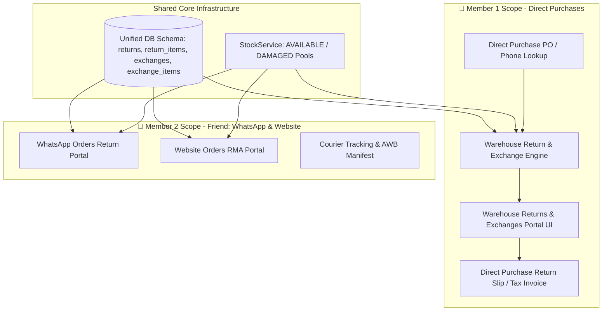

# 2-Member Implementation Plan — Customer Returns & Exchanges System

This plan divides the Returns & Exchanges development across **2 team members**:
- 👤 **Member 1 (Your Scope — To Develop Now)**: **Warehouse Direct Purchases Customer Returns & Exchanges** (Complete engine, database migration, lookup, size/color exchange, catalog exchange, stock management, price difference calculation, tax receipt, and navigation).
- 👥 **Member 2 (Friend's Scope — Blueprint & Roadmap)**: **WhatsApp Orders & Website Orders Returns & Exchanges** (Specifications, API contracts, and view architecture for your friend).

---



---

## 👤 Part 1: Member 1 Scope — Warehouse Direct Purchases Returns & Exchanges

### 1. Database Schema Support
#### [MODIFY] [database/schema.sql](file:///c:/xampp/htdocs/grm_inventory/database/schema.sql)
Ensure `returns` and `exchanges` support Direct Warehouse Purchases:
- `returns`: Add `source_type` ENUM(`'SHOP'`, `'WAREHOUSE_PURCHASE'`, `'WHATSAPP'`, `'WEBSITE'`) DEFAULT `'SHOP'`, `purchase_order_id` INT UNSIGNED NULL.
- `exchanges`: Add `purchase_order_id` INT UNSIGNED NULL, `settlement_mode` VARCHAR(50) DEFAULT `'CASH'`.

---

### 2. Backend Engine & Services

#### [MODIFY] [app/Services/WarehouseService.php](file:///c:/xampp/htdocs/grm_inventory/app/Services/WarehouseService.php)
1. **`lookupPurchaseForReturn(string $query, int $warehouseId)`**:
   - Searches `purchase_orders` + `purchase_items` by PO Number (`PO-YYYYMMDD-XXXX`), Invoice Number, or Customer Phone.
   - Joins `product_variants`, `products`, `sizes`, `colors`.
   - Fetches available **sibling variants** (same product in other sizes/colors) with live Warehouse stock.
2. **`processPurchaseReturn(array $payload, int $userId)`**:
   - Generates unique return sequence: `RET-WH-YYYYMMDD-XXXX` (Returns) or `EXC-WH-YYYYMMDD-XXXX` (Exchanges).
   - Handles:
     - **Mode A: Direct Return & Refund** (Cash, UPI, Bank Transfer, or Credit Note).
     - **Mode B: Same-Product Size/Color Swap** (In-place replacement with sibling variant).
     - **Mode C: Different-Product Catalog Exchange** (Pick alternate warehouse catalog item).
   - **Real-Time Price Difference & Balance**:
     - `Diff = Total New Replacement Amount - Total Refund Amount`
     - If `Diff > 0` -> Payment Action: `COLLECT` from customer.
     - If `Diff < 0` -> Payment Action: `REFUND` to customer.
     - If `Diff == 0` -> Payment Action: `NONE` (Even exchange).
   - **Atomic Stock Management**:
     - Returned `GOOD` items -> Restocked to Warehouse `AVAILABLE` stock (`location_type = 'WAREHOUSE'`).
     - Returned `DAMAGED` items -> Restocked to Warehouse `DAMAGED` stock pool.
     - Replacement items -> Deducted from Warehouse `AVAILABLE` stock.
   - **Transaction Logging**:
     - Inserts atomic records in `returns`, `return_items`, `exchanges`, and `exchange_items`.
     - Logs cash/UPI ledger if cash refunded.
3. **`getPurchaseReturnsSummary(int $warehouseId)`**:
   - Computes KPI metrics: Total Transactions, Direct Refunds (₹), Active Exchanges, Items Returned (Pcs).
4. **`getPurchaseReturnsList(array $filters, int $warehouseId)`**:
   - Paginated/filtered history of all Warehouse Direct Purchase returns and exchanges.

---

### 3. Routes & Controller

#### [MODIFY] [routes/web.php](file:///c:/xampp/htdocs/grm_inventory/routes/web.php)
```php
// Warehouse Direct Purchases Returns & Exchanges
$this->get('warehouse/purchases/returns', 'WarehouseController', 'purchaseReturnsIndex', ['AuthMiddleware']);
$this->get('warehouse/purchases/returns/lookup', 'WarehouseController', 'purchaseReturnsLookup', ['AuthMiddleware']);
$this->post('warehouse/purchases/returns/process', 'WarehouseController', 'processPurchaseReturn', ['AuthMiddleware']);
$this->get('warehouse/purchases/returns/view/{id}', 'WarehouseController', 'purchaseReturnView', ['AuthMiddleware']);
$this->get('warehouse/purchases/returns/invoice/{id}', 'WarehouseController', 'purchaseReturnInvoice', ['AuthMiddleware']);
```

#### [MODIFY] [app/Controllers/WarehouseController.php](file:///c:/xampp/htdocs/grm_inventory/app/Controllers/WarehouseController.php)
- Implement `purchaseReturnsIndex()`: Renders the returns portal with KPI cards, history table, and search.
- Implement `purchaseReturnsLookup()`: AJAX endpoint to lookup direct purchases and return items + sibling variants.
- Implement `processPurchaseReturn()`: Validates CSRF and payload, calls `WarehouseService::processPurchaseReturn`, flashes success/error, redirects to invoice.
- Implement `purchaseReturnView(int $id)`: Detailed view of return/exchange audit breakdown.
- Implement `purchaseReturnInvoice(int $id)`: Clean, printable A4 / POS Tax Receipt with GST breakdown and exchange notes.

---

### 4. User Interface & Views

#### [NEW] [views/warehouse/purchases/returns.php](file:///c:/xampp/htdocs/grm_inventory/views/warehouse/purchases/returns.php)
- **Top Header**: Module badge, Direct Purchases breadcrumbs, shortcuts to Direct Purchase list and Warehouse Stock.
- **5 Interactive Quick Analysis Cards**:
  1. All Transactions (Cases & Pcs)
  2. Direct Refunds Issued (₹ Amount & Count)
  3. Size/Color Exchanges (Swaps & Value)
  4. Multi-Product Exchanges (New items picked)
  5. Damaged Returned Pieces (Routing to QC/Damage pool)
- **Search & Lookup Card**: Search PO number, Invoice number, or Customer phone with auto-suggest.
- **Interactive In-Place Return & Exchange Modal**:
  - Item selector with quantities.
  - Condition classifier: `GOOD` (Resellable) vs `DAMAGED` (Defective).
  - Mode Tabs: Direct Refund / Same-Product Size & Color Swap / Different Product Catalog Selector.
  - Real-time Price Difference pill (`COLLECT ₹XX` / `REFUND ₹XX` / `EVEN SWAP ₹0.00`).
- **History Data Table**: Filter by Status, Date range, and Return Type with action buttons to View & Print Slip.

#### [NEW] [views/warehouse/purchases/return_invoice.php](file:///c:/xampp/htdocs/grm_inventory/views/warehouse/purchases/return_invoice.php)
- Printable Tax Invoice & Exchange Slip with company header, customer details, returned items, replacement items, price difference summary, and authorized signature.

#### [MODIFY] [views/layouts/main.php](file:///c:/xampp/htdocs/grm_inventory/views/layouts/main.php)
- Add submenu item under **Warehouse Direct Purchases**:
  - `<li><a href="<?= url('warehouse/purchases/returns') ?>">Returns &amp; Exchanges</a></li>`

---

## 👥 Part 2: Member 2 Scope (Friend's Blueprint) — WhatsApp & Website Orders

> [!NOTE]
> This section serves as the complete technical blueprint and API contract for your friend (Abi) to implement WhatsApp Orders and Website Orders Returns & Exchanges.

### 1. WhatsApp Orders Returns (`warehouse/whatsapp-orders/returns`)
- **Controller Methods**:
  - `whatsappReturnsIndex()`: KPI cards for WhatsApp channel returns.
  - `whatsappReturnsLookup()`: Search `sales` (where `sales_channel = 'WHATSAPP'`) by Invoice Number or Phone.
  - `processWhatsappReturn()`: Restocks to WhatsApp channel allocation, deducts replacement variant, logs courier tracking/AWB.
- **Views**:
  - `views/warehouse/whatsapp_orders/returns.php`
  - `views/warehouse/whatsapp_orders/return_invoice.php`
- **Submenu**: Add `Returns & Exchanges` under WhatsApp Orders nav menu.

### 2. Website Orders RMA (`warehouse/website-orders/returns`)
- **Controller Methods**:
  - `websiteReturnsIndex()`: eCommerce RMA dashboard.
  - `websiteReturnsLookup()`: Search `sales` (where `sales_channel = 'WEBSITE'`) by Order ID, Invoice, Email, or AWB.
  - `processWebsiteReturn()`: Restocks to Website channel allocation, processes gateway refund or size exchange, prints return shipping label.
- **Views**:
  - `views/warehouse/website_orders/returns.php`
  - `views/warehouse/website_orders/return_invoice.php`
- **Submenu**: Add `Returns & Exchanges` under Website Orders nav menu.

---

## Verification Plan for Member 1 (Direct Purchases)

### Automated / Script Tests
1. **PO Lookup Verification**: Verify lookup endpoint accurately returns purchase order items and all available sibling variants in warehouse stock.
2. **Stock Swap Verification**:
   - Same-product size exchange: Returned item (+1 available warehouse stock), replacement item (-1 available warehouse stock).
   - Damaged return: Returned item (+1 damaged warehouse stock), replacement item (-1 available warehouse stock).
3. **Price Difference Calculation**: Verify `COLLECT`, `REFUND`, and `EVEN SWAP` math.

### Manual Verification
1. Open `/warehouse/purchases/returns` in browser.
2. Search a Direct Purchase PO / Phone number.
3. Perform a Size Exchange (e.g., Size M -> Size L).
4. Verify instant stock updates in `/warehouse/stock`.
5. View and print the Return & Exchange Tax Slip.
